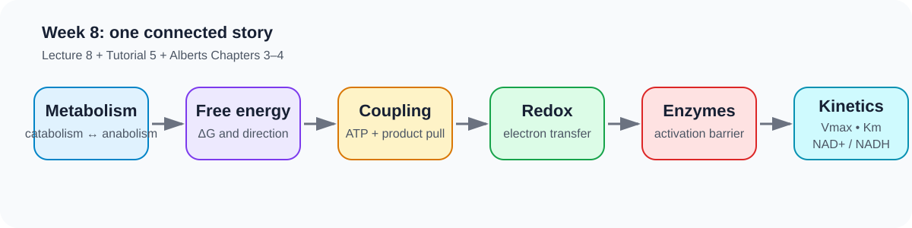
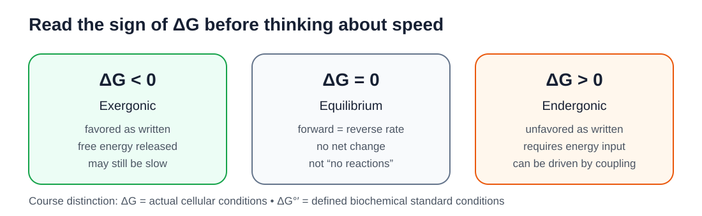
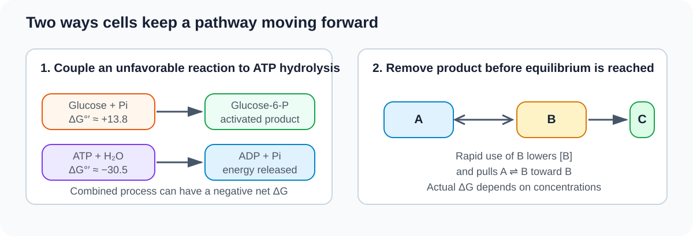
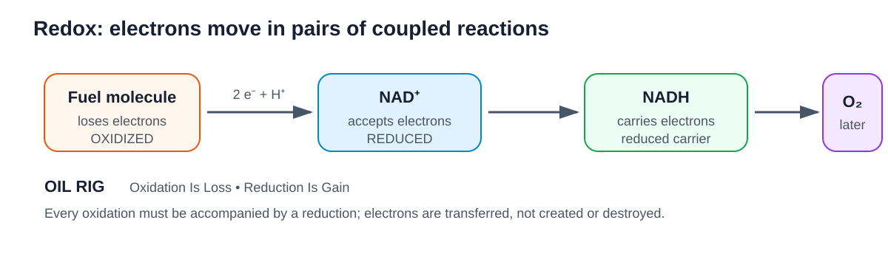
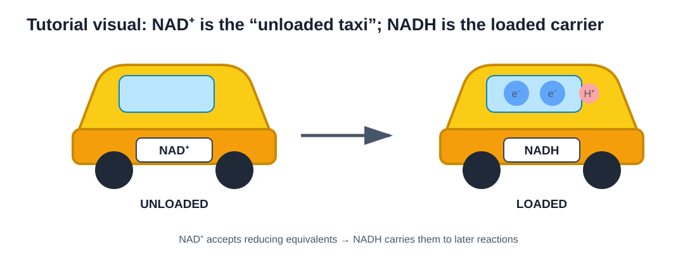
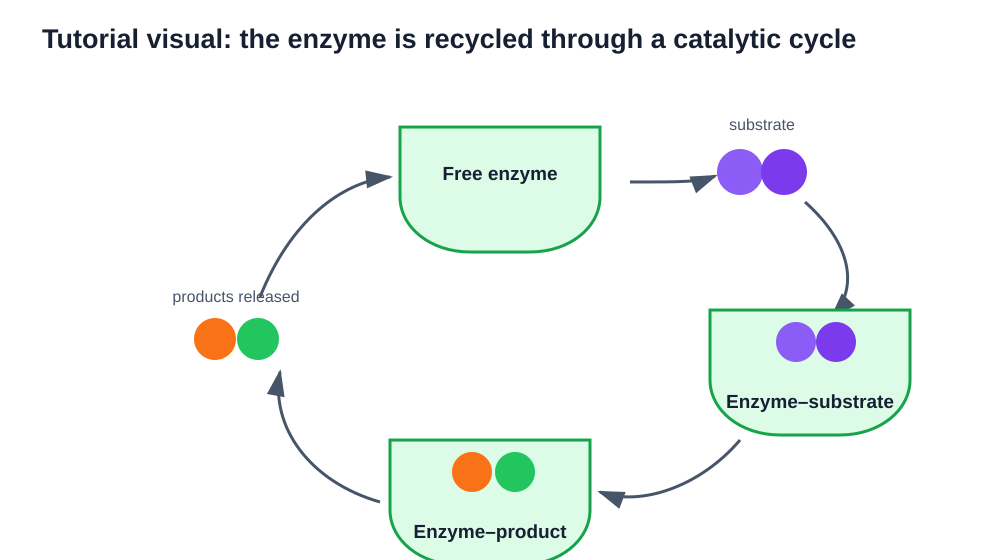
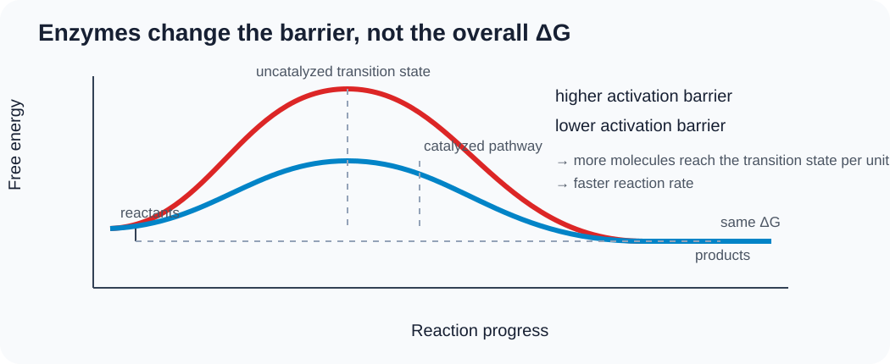
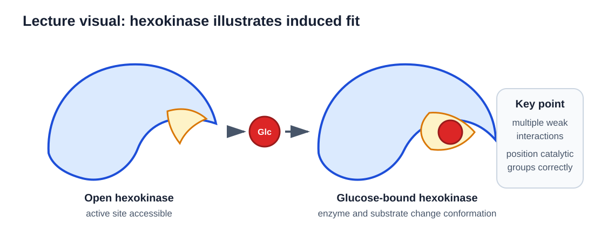
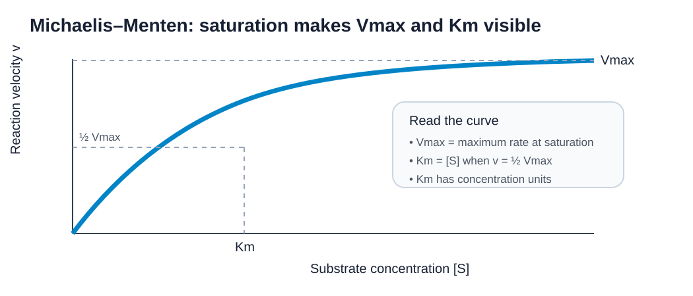

## How to use this guide

The Week 8 lecture defines what you are expected to know. The detailed explanations below draw on Alberts et al., *Essential Cell Biology*, Chapters 3 and 4, but the guide does **not** attempt to reproduce every topic in those chapters.

The main chain for this week is:

**metabolism → free energy → reaction direction → coupling → redox → enzymes → activation energy → reaction rate → Vmax and Km → NAD+/NADH**

<figure class="study-visual study-visual-wide">

<figcaption><strong>Visual roadmap.</strong> Use this as the organizing map for the week: each topic leads into the next rather than standing alone. Source synthesis: Week 8 lecture; Tutorial 5; Alberts Chapters 3–4.</figcaption>
</figure>

## 1. Metabolism: the whole network

**Metabolism** means the complete set of chemical processes that occur continuously in a living cell or organism.

Two broad directions are useful:

- **Catabolism:** breaking larger molecules into smaller molecules, commonly releasing usable energy and producing smaller building blocks.
- **Anabolism:** building larger molecules from smaller ones, generally requiring an input of energy and reducing power.

These processes are linked. Catabolism does not simply “destroy” molecules; it provides energy and intermediates that can support anabolic reactions.

### Metabolomics

**Metabolomics** is the systematic identification and measurement of the small-molecule metabolites present in a biological system at a particular time.

A metabolome is dynamic. It changes with diet, disease, drug treatment, exercise, cell type, and physiological state. For this reason, metabolomics can be used to identify biomarkers, characterize disease states, and compare metabolic responses.

## 2. Bioenergetics

**Bioenergetics** is the quantitative study of how organisms obtain, transform, store, and use energy.

Cells need a continuous energy supply because cellular organization is not maintained passively. Energy is required for synthesis, transport, movement, signaling, growth, and reproduction.

### The first and second laws

The **first law of thermodynamics** states that energy is not created or destroyed; it is transferred or transformed.

The **second law of thermodynamics** states that the total disorder, or entropy, of an isolated system tends to increase.

Cells can become more ordered locally because they are not isolated systems. They take in energy and matter and release heat and waste to their surroundings.

## 3. Gibbs free energy

**Gibbs free energy (G)** represents the energy in a system that is available to do useful work under the relevant conditions.

For a chemical reaction, the important quantity is the **change in free energy**:

$$
\Delta G = G_{products} - G_{reactants}
$$

The sign of $\Delta G$ tells you the thermodynamic direction favored under the **actual cellular conditions**.

### If ΔG is negative

A reaction with $\Delta G<0$ is:

- **exergonic**;
- thermodynamically favorable in the direction written;
- associated with a net release of free energy.

“Favorable” or “spontaneous” does **not** mean “fast.” A favorable reaction can still be extremely slow if it has a high activation-energy barrier.

### If ΔG is positive

A reaction with $\Delta G>0$ is:

- **endergonic**;
- thermodynamically unfavorable in the direction written;
- dependent on an input of free energy if it is to proceed appreciably in that direction.

### If ΔG is zero

At $\Delta G=0$ the system is at **equilibrium**:

- forward and reverse reactions still occur;
- their rates are equal;
- there is no **net** change in reactant and product concentrations.

A living cell is maintained away from equilibrium. At equilibrium, there is no net chemical driving force available to sustain metabolism.

<figure class="study-visual">

<figcaption><strong>How to read ΔG.</strong> First decide whether the process is thermodynamically favored; only then ask how fast it proceeds. Lecture slides 8:7–8:8; Tutorial 5 Gibbs free-energy review; Alberts Chapter 3, Free Energy and Catalysis.</figcaption>
</figure>

## 4. ΔG versus ΔG°′

These two quantities answer different questions.

- **$\Delta G$** describes the free-energy change under the actual concentrations and conditions present in the cell.
- **$\Delta G^{\circ\prime}$** is the standard transformed free-energy change measured under defined biochemical standard conditions.

Therefore, a reaction with a positive $\Delta G^{\circ\prime}$ can still proceed forward in a cell if cellular concentrations make the actual $\Delta G$ negative.

This distinction is central to understanding pathways: cells manipulate reactant and product concentrations.

## 5. Two ways cells drive pathways forward

### Strategy 1: couple an unfavorable reaction to a favorable reaction

Cells often combine an endergonic reaction with an exergonic reaction so that the **sum** of the free-energy changes is negative.

A classic example is ATP hydrolysis:

$$
ATP + H_2O \rightarrow ADP + P_i
$$

with a strongly negative standard free-energy change.

Phosphoryl transfer from ATP can be coupled directly to another reaction. The overall coupled process can then become favorable even if one component reaction is unfavorable on its own.

### Strategy 2: remove the product

For a reversible reaction:

$$
A \rightleftharpoons B
$$

continual use of B by the next step lowers the concentration of B. This “pulls” the reaction toward B and can make the actual $\Delta G$ favorable.

This is why pathway direction cannot be understood from $\Delta G^{\circ\prime}$ alone.

<figure class="study-visual study-visual-wide">

<figcaption><strong>Two ways to drive a pathway forward.</strong> The left panel mirrors the lecture's ATP–glucose coupling example; the right panel shows the product-removal logic used for sequential metabolic reactions. Lecture slides 8:9–8:10; Tutorial 5 coupling exercise; Alberts Chapter 3.</figcaption>
</figure>

## 6. ATP is an activated carrier

ATP is one of the cell's most widely used **activated carriers**.

Its importance is not that “breaking a phosphate bond releases energy” in isolation. The overall hydrolysis reaction is favorable because the products are more stable than ATP under cellular conditions.

Important contributors include:

- reduced electrostatic repulsion after hydrolysis;
- resonance stabilization of inorganic phosphate;
- favorable hydration/solvation of products.

The products therefore sit at a lower free-energy state.

## 7. Oxidation and reduction

Many metabolic reactions transfer electrons.

- **Oxidation:** loss of electrons.
- **Reduction:** gain of electrons.

A useful mnemonic is **OIL RIG**:

**Oxidation Is Loss; Reduction Is Gain.**

Oxidation and reduction are always coupled. If one molecule loses electrons, another must accept them.

### Recognizing redox changes in carbon compounds

For organic molecules:

- an increase in C–H bonds generally indicates **reduction**;
- a decrease in C–H bonds, or an increase in bonding to electronegative atoms such as oxygen, generally indicates **oxidation**.

Food oxidation occurs in many small enzymatic steps rather than in one uncontrolled reaction. This allows cells to capture free energy efficiently.

## 8. NAD+ and NADH

Electrons are not carried freely through the aqueous interior of a cell. Cells use electron carriers.

**NAD+** is an oxidized electron carrier. It can accept electrons during the oxidation of another molecule.

In a typical dehydrogenase reaction:

$$
NAD^+ + 2e^- + H^+ \rightarrow NADH
$$

NADH is therefore the **reduced** form.

Conceptually:

- NAD+ accepts reducing equivalents during fuel oxidation;
- NADH carries high-energy electrons to other reactions, including later steps in cellular respiration.

Do not describe NADH as “energy itself.” It is an activated carrier whose electrons can be transferred through later reactions.

<figure class="study-visual study-visual-wide">

<figcaption><strong>Redox handoff.</strong> Oxidation and reduction always occur together: fuel loses electrons, NAD+ accepts them, and NADH carries them onward. Lecture slides 8:14–8:17 and 8:28; Tutorial 5 redox/electron-carrier review; Alberts Chapter 3.</figcaption>
</figure>

<figure class="study-visual course-source-visual">

<figcaption><strong>Tutorial 5 visual analogy — the NAD taxi.</strong> This preserves the tutorial's memorable “unloaded/loaded taxi” model: NAD+ accepts reducing equivalents and becomes NADH; NADH later donates those electrons and returns to the oxidized form. Faithful course-site adaptation of Tutorial 5, “Electron carriers (more soon!).”</figcaption>
</figure>

## 9. Enzymes and catalysis

An **enzyme** is a biological catalyst, usually a protein.

A **catalyst** increases the rate of a chemical reaction without being consumed by the reaction.

The basic sequence is:

$$
E + S \rightleftharpoons ES \rightarrow EP \rightarrow E + P
$$

where:

- E = enzyme;
- S = substrate;
- ES = enzyme–substrate complex;
- P = product.

The substrate binds at the **active site**, where the enzyme creates a chemical environment favorable for conversion to product.

<figure class="study-visual course-source-visual">

<figcaption><strong>Tutorial 5 enzyme-cycle visual.</strong> The enzyme is recycled: substrate binding forms an enzyme–substrate complex, chemistry produces an enzyme–product complex, products leave, and the enzyme is ready for another catalytic cycle. Faithful course-site adaptation of Tutorial 5, “Enzymes are specific for substrates.”</figcaption>
</figure>

## 10. The transition state and activation energy

Even when a reaction has a negative $\Delta G$, reactants must pass through a high-energy, unstable configuration called the **transition state**.

The energy needed to reach that state is the **activation energy**.

Enzymes accelerate reactions primarily by lowering the activation-energy barrier. They can do this by:

- bringing substrates together in the correct orientation;
- straining particular bonds;
- creating favorable charge environments;
- participating transiently in bond-making or bond-breaking;
- binding the transition state especially well.

### What enzymes do not change

Enzymes do **not** change:

- the overall $\Delta G$ of the reaction;
- the equilibrium constant;
- the final equilibrium ratio of reactants to products.

They accelerate both forward and reverse reactions toward equilibrium.

<figure class="study-visual">

<figcaption><strong>Thermodynamics versus kinetics.</strong> The enzyme lowers the transition-state barrier but leaves the reactant-to-product free-energy difference unchanged. Lecture slide 8:22; Tutorial 5 enzyme-catalysis review; Alberts Chapter 4, How Proteins Work.</figcaption>
</figure>

## 11. Enzyme binding and induced fit

An enzyme active site is not necessarily a rigid lock.

Substrate binding can cause a conformational adjustment called **induced fit**. This can position catalytic groups correctly and help push the substrate toward the transition state.

Specificity therefore depends on complementary chemical interactions and the ability of the active site to support the reaction.

<figure class="study-visual course-source-visual">

<figcaption><strong>Lecture 8 hexokinase example.</strong> The Week 8 lecture uses glucose binding to hexokinase to make induced fit concrete: binding changes the enzyme's conformation and positions catalytic groups around the substrate. Faithful course-site adaptation of Lecture 8:21, “Enzymes are specific for substrates and change conformation when substrate binds.”</figcaption>
</figure>

## 12. Reaction velocity

For an enzyme-catalyzed reaction, **velocity** or **rate** refers to how quickly substrate is converted into product.

It can be expressed as:

- product formed per unit time; or
- substrate consumed per unit time.

Because a rate includes time, its units always contain a time component, such as:

- μmol product/min;
- mol L$^{-1}$ s$^{-1}$.

## 13. Vmax

At low substrate concentration, adding more substrate usually increases the reaction rate because more enzyme molecules form enzyme–substrate complexes.

Eventually, substrate becomes abundant enough that essentially all available active sites are occupied most of the time.

The rate then approaches **Vmax**, the maximum velocity possible for that amount of enzyme under those conditions.

At Vmax:

- the enzyme is operating near saturation;
- adding more substrate produces little or no further increase in rate.

Vmax is a **rate**, so it has rate units.

## 14. Km

For the standard Michaelis–Menten description, **Km** is the substrate concentration at which the reaction rate is half of Vmax:

$$
v=\frac{V_{max}}{2} \quad \text{when} \quad [S]=K_m
$$

Therefore:

- Km is a **concentration**;
- its units are concentration units such as M, mM, or μM.

For this course, remember the operational definition first: **Km is the substrate concentration that gives half-maximal velocity.**

A lower Km often corresponds to an enzyme reaching substantial activity at a lower substrate concentration, but Km should not automatically be treated as a universal synonym for binding affinity.

<figure class="study-visual">

<figcaption><strong>Read the saturation curve.</strong> Vmax is a rate; Km is the substrate concentration at one-half Vmax. Lecture slides 8:23–8:26; Tutorial 5 Km review; Alberts Chapter 4 enzyme context.</figcaption>
</figure>

::: {.callout-note title="Exam reading habit"}
When you see an enzyme-kinetics graph, identify the **axes first**. Then locate the plateau (Vmax), take one-half of that rate, and read down to the substrate axis to obtain Km.
:::

## 15. Connecting thermodynamics and kinetics

This distinction is essential:

- **Thermodynamics** asks whether a process is energetically favorable and where equilibrium lies.
- **Kinetics** asks how rapidly a process occurs.

$\Delta G$ tells you about **direction/favorability**.

Activation energy, enzyme concentration, substrate concentration, Vmax, and Km help describe **rate**.

A reaction can be thermodynamically favorable but kinetically slow.

## 16. Week 8 learning-objective checklist

You should now be able to answer, without notes:

- What are catabolism and anabolism?
- What is metabolomics?
- What does Gibbs free energy describe?
- What does $\Delta G$ tell us?
- How does $\Delta G$ differ from $\Delta G^{\circ\prime}$?
- What do exergonic, endergonic, and equilibrium mean?
- How do coupling and product removal drive pathways forward?
- What are oxidation and reduction?
- What is an enzyme?
- What is catalysis?
- What happens when an enzyme binds substrate?
- What is the transition state?
- How do enzymes accelerate reactions?
- What does reaction rate/velocity mean?
- What is Vmax?
- What is Km, and what are its units?
- What are the roles of NAD+ and NADH?

## Takeaway

Week 8 is easiest to understand as a sequence of two questions:

1. **Can the reaction go?** — use free energy and $\Delta G$.
2. **How fast will it go?** — use activation energy, catalysis, and enzyme kinetics.

Cells survive by controlling both.
