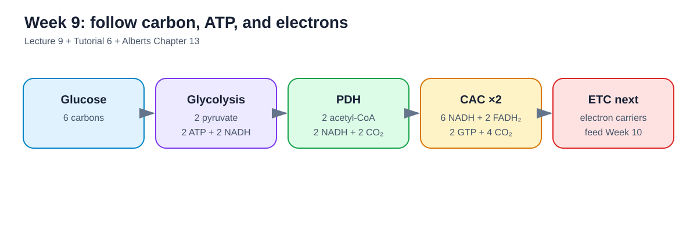
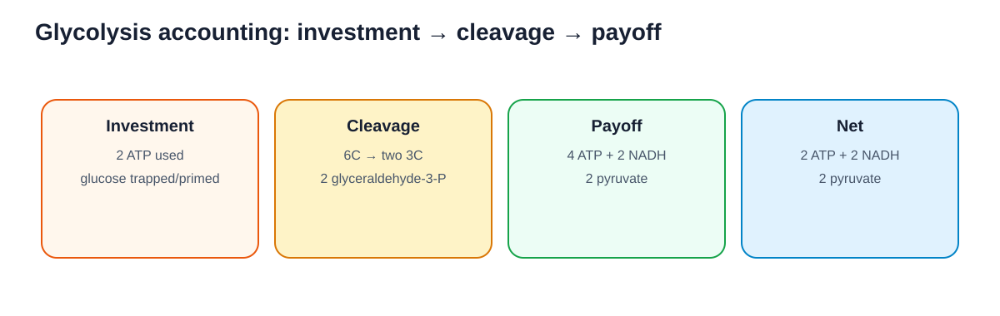
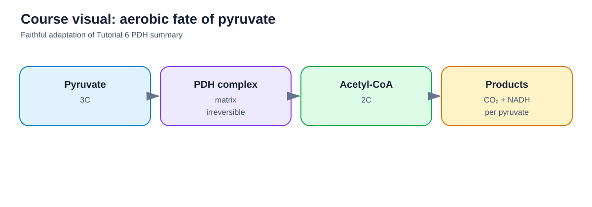
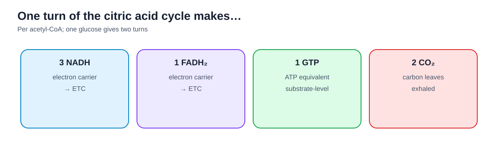
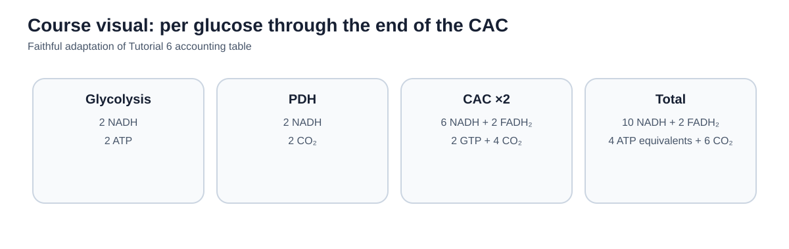
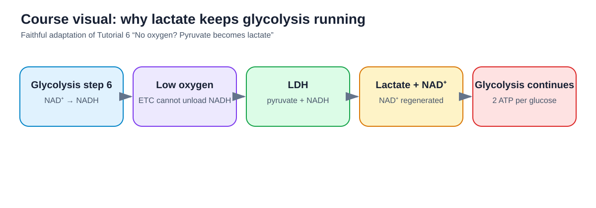
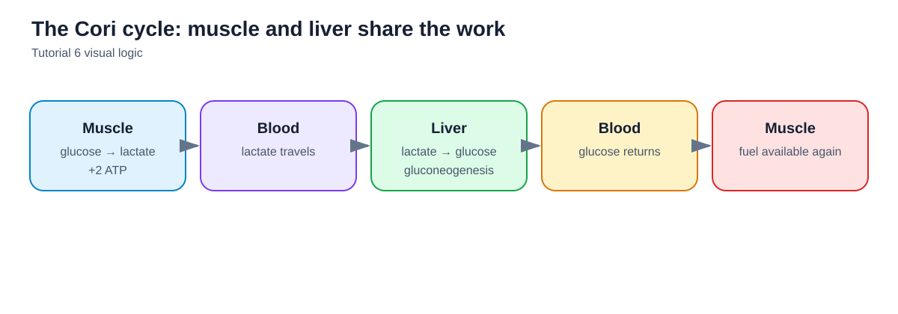

## How to use this guide

The Week 9 lecture defines the examinable scope. Alberts Chapter 13 provides the detailed biochemical background. Tutorial 6 is used as a cross-check for the transition from pyruvate and the citric acid cycle into Week 10.

The main chain is:

**polysaccharides → glucose → glycolysis → pyruvate → acetyl-CoA → citric acid cycle → NADH/FADH2 → electron transport**

Under limited oxygen:

**pyruvate → lactate → NAD+ regeneration → Cori cycle**

<figure class="study-visual">

<figcaption><strong>Visual roadmap.</strong> Lecture 9; Tutorial 6; Alberts Chapter 13.</figcaption>
</figure>

## 1. Nutritional polysaccharides

The lecture emphasizes three glucose polymers:

- **Amylose** — a linear plant starch with glucose units linked mainly by α(1→4) glycosidic bonds.
- **Amylopectin** — a branched plant starch with α(1→4) chains and α(1→6) branch points.
- **Glycogen** — the main glucose-storage polysaccharide in animals; it uses the same linkage types as amylopectin but is **more highly branched**.

The important distinction is therefore not the identity of the monomer—all three are made of glucose—but the degree and pattern of branching.

## 2. Glycolysis: overall result

Glycolysis takes place in the **cytosol** and converts one six-carbon glucose into two three-carbon pyruvates.

Per glucose:

- **2 ATP are invested**
- **4 ATP are produced**
- **net ATP = 2**
- **2 NADH are produced**
- **2 pyruvate are produced**

The pathway is often divided into three conceptual stages:

1. **Energy-investment / trapping stage**
2. **Cleavage into two three-carbon intermediates**
3. **Energy-payoff stage**

<figure class="study-visual">

<figcaption><strong>Glycolysis accounting.</strong> Lecture 9:6–9:20; Alberts Chapter 13.</figcaption>
</figure>

## 3. Reaction 1: phosphorylation of glucose

The first reaction is:

**glucose → glucose-6-phosphate**

The enzyme is a **hexokinase**; in liver, the lecture specifically emphasizes **hexokinase IV (glucokinase)**.

Phosphorylation traps glucose in the cell because glucose-6-phosphate is not transported through the GLUT transporter in the same way as free glucose.

### Liver glucokinase regulation

The lecture emphasizes a liver-specific regulatory idea:

- at relatively low glucose levels, glucokinase can be sequestered in the nucleus by a regulatory protein;
- glucose entering via GLUT2 is therefore not necessarily phosphorylated immediately;
- when glucose rises sufficiently, glucokinase is released into the cytosol;
- excess glucose is then phosphorylated and retained in the hepatocyte.

The conceptual point is that the liver helps buffer high blood glucose rather than trapping every molecule of glucose immediately.

## 4. Reaction 2: isomerization

**glucose-6-phosphate → fructose-6-phosphate**

The enzyme is **phosphoglucose isomerase**.

Why is this useful? Moving the carbonyl from carbon 1 to carbon 2 prepares the molecule so that another phosphate can be added and the six-carbon sugar can later be split into two phosphorylated three-carbon molecules.

## 5. Reaction 3: second phosphorylation

**fructose-6-phosphate → fructose-1,6-bisphosphate**

This is the second ATP-investing step.

At the end of the first three reactions, the cell has carried out:

**phosphorylation → isomerization → phosphorylation**

The six-carbon substrate is now prepared for cleavage.

## 6. Reactions 4 and 5: cleavage and rearrangement

Fructose-1,6-bisphosphate is split into two three-carbon compounds.

For this course, the key net outcome is:

**2 molecules of glyceraldehyde-3-phosphate per glucose**

Everything after this point happens **twice per original glucose molecule**.

## 7. Reaction 6: three major consequences

The glyceraldehyde-3-phosphate dehydrogenase reaction is particularly important.

Three consequences emphasized in the lecture are:

1. **NAD+ is reduced to NADH**
2. **glyceraldehyde-3-phosphate is oxidized**
3. **1,3-bisphosphoglycerate (1,3-BPG)** is formed, a high-transfer-potential intermediate that can drive ATP formation in the next reaction

The lecture also emphasizes why NAD+ regeneration becomes crucial during anaerobic glycolysis.

## 8. Reaction 7: first ATP-producing step

1,3-BPG transfers a phosphate to ADP.

This is **substrate-level phosphorylation**: ATP is formed directly by transfer of a phosphate group from a high-energy substrate to ADP.

Because there are two 1,3-BPG molecules per glucose, reaction 7 produces **2 ATP per glucose**.

But the net ATP yield at this point is still **zero**, because 2 ATP were already invested earlier.

## 9. Reactions 8–10 and the net ATP gain

Reaction 8 rearranges the phosphate position.

Reaction 9 forms **phosphoenolpyruvate (PEP)**, another compound with very high phosphate-transfer potential.

Reaction 10 transfers phosphate from PEP to ADP, generating another **2 ATP per glucose**.

Thus:

- 2 ATP invested
- 4 ATP generated
- **net = 2 ATP**

Glycolysis ends with **2 pyruvate + 2 NADH + net 2 ATP**.

## 10. Three metabolic fates of pyruvate

The lecture expects you to recognize three broad possibilities:

1. **Aerobic oxidation:** pyruvate enters mitochondria and is converted to acetyl-CoA.
2. **Lactate formation:** in oxygen-limited muscle, pyruvate accepts electrons from NADH, regenerating NAD+.
3. **Fermentation in other organisms:** pyruvate can be converted into other fermentation products such as ethanol.

For this course, the main human comparison is aerobic oxidation versus lactate formation.

## 11. Pyruvate dehydrogenase complex

Under aerobic conditions, pyruvate is transported into the **mitochondrial matrix**.

The **pyruvate dehydrogenase complex (PDH)** converts:

**pyruvate + CoA + NAD+ → acetyl-CoA + CO2 + NADH**

Per pyruvate:

- 1 acetyl-CoA
- 1 CO2
- 1 NADH

Per glucose, because glycolysis produces 2 pyruvates:

- **2 acetyl-CoA**
- **2 CO2**
- **2 NADH**

This reaction is treated as **irreversible** in the lecture: acetyl-CoA cannot simply be converted back into pyruvate.

<figure class="study-visual course-source-visual">

<figcaption><strong>Course visual — aerobic fate of pyruvate.</strong> Faithful adaptation of Tutorial 6:2 and Lecture 9:22.</figcaption>
</figure>

## 12. Acetyl-CoA as a metabolic hub

Coenzyme A contains a reactive thiol group that carries the two-carbon acetyl group through a high-energy thioester linkage.

Acetyl-CoA can arise from:

- pyruvate derived from carbohydrate;
- fatty acid breakdown;
- parts of amino acid metabolism.

It can feed:

- the **citric acid cycle**;
- biosynthetic pathways, including fatty acid synthesis.

The key course point is that acetyl-CoA cannot be used to reverse the PDH reaction and regenerate pyruvate.

## 13. Citric acid cycle: purpose

The citric acid cycle (CAC) occurs in the mitochondrial matrix.

Its most important energetic role in this lecture is to load electron carriers for the electron-transport chain.

One turn of the CAC per acetyl-CoA produces:

- **3 NADH**
- **1 FADH2**
- **1 GTP**
- **2 CO2**

The GTP can be converted to ATP.

<figure class="study-visual">

<figcaption><strong>One CAC turn.</strong> Lecture 9:25; Tutorial 6:4.</figcaption>
</figure>

## 14. Stoichiometry per glucose through the CAC

### Glycolysis

- 2 NADH
- 2 ATP net
- 0 CO2

### Pyruvate dehydrogenase, two turns

- 2 NADH
- 2 CO2

### CAC, two turns

- 6 NADH
- 2 FADH2
- 2 GTP
- 4 CO2

### Total through the end of the CAC

- **10 NADH**
- **2 FADH2**
- **4 ATP equivalents** (2 ATP from glycolysis + 2 GTP)
- **6 CO2**

All six carbons originally present in glucose have now been released as CO2.

<figure class="study-visual course-source-visual">

<figcaption><strong>Course visual — full per-glucose accounting.</strong> Faithful adaptation of Tutorial 6:5 and Lecture 9:26.</figcaption>
</figure>

## 15. Anaplerotic reactions

CAC intermediates can be withdrawn for biosynthesis.

**Anaplerotic reactions** replenish those intermediates so that the cycle can continue.

The lecture specifically emphasizes that carbon skeletons from amino acids can enter the CAC at several points and help refill the pool of intermediates.

## 16. Anaerobic glycolysis and lactate

When oxygen is limiting, the electron-transport chain cannot serve as the normal route for reoxidizing NADH.

But glycolysis requires **NAD+** at reaction 6.

Lactate dehydrogenase solves this problem:

**pyruvate + NADH → lactate + NAD+**

The key purpose is therefore **not** to make additional ATP directly. It is to regenerate NAD+ so glycolysis can continue producing its net 2 ATP per glucose.

<figure class="study-visual course-source-visual">

<figcaption><strong>Course visual — why lactate keeps glycolysis running.</strong> Faithful adaptation of Tutorial 6:7 and Lecture 9:31.</figcaption>
</figure>

## 17. The Cori cycle

In exercising muscle:

- glucose is converted to pyruvate;
- pyruvate is reduced to lactate;
- lactate leaves the muscle and enters the blood.

The liver takes up lactate and converts it back into glucose through gluconeogenesis.

That glucose can return to the circulation and be used again by muscle.

This muscle–liver exchange is the **Cori cycle**.

<figure class="study-visual">

<figcaption><strong>The Cori cycle.</strong> Lecture 9:32; Tutorial 6:8.</figcaption>
</figure>

## 18. Week 9 learning-objective checklist

You should be able to explain without notes:

- amylose, amylopectin, and glycogen;
- α(1→4) versus α(1→6) glycosidic bonds;
- the overall products of glycolysis;
- the three conceptual stages of glycolysis;
- reactions 1–7 and why they matter;
- why reactions 4–5 yield two glyceraldehyde-3-phosphates;
- why reaction 7 gives zero net ATP at that point;
- how glycolysis finishes with net 2 ATP;
- three fates of pyruvate;
- PDH products;
- the role of acetyl-CoA;
- products of one CAC turn and totals per glucose;
- anaplerotic reactions;
- lactate formation and NAD+ regeneration;
- the Cori cycle.

## Takeaway

Week 9 is a carbon-and-electron accounting problem.

Follow three things:

**carbon atoms → ATP/GTP → electron carriers**

If you can track those through glycolysis, PDH, and the CAC, the pathway becomes much easier to reconstruct.
