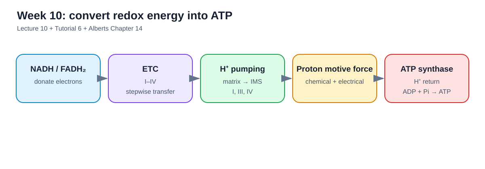
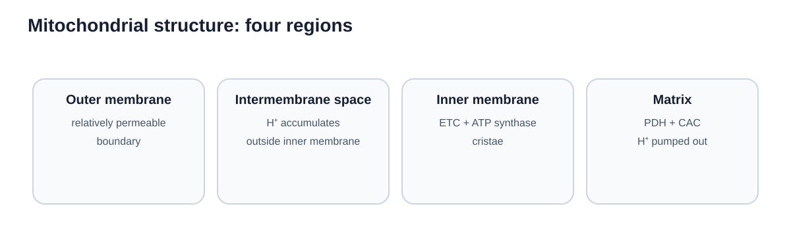
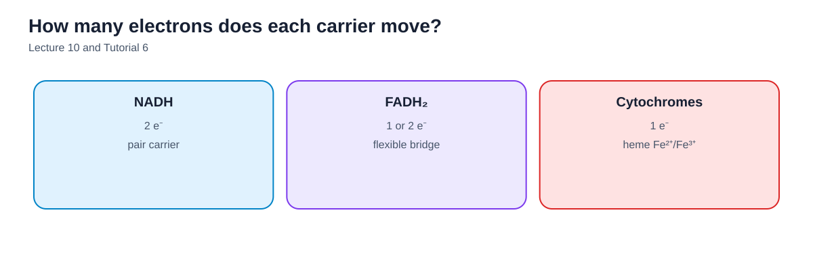
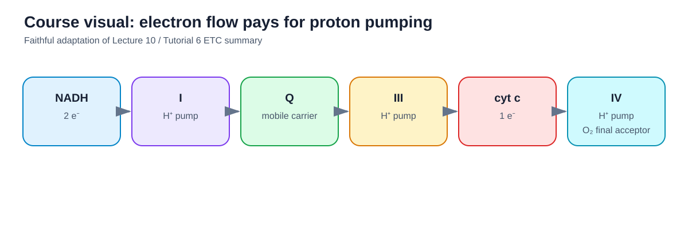
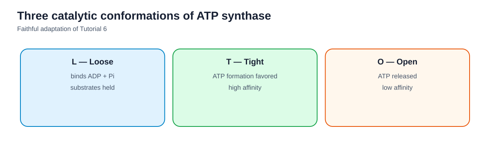
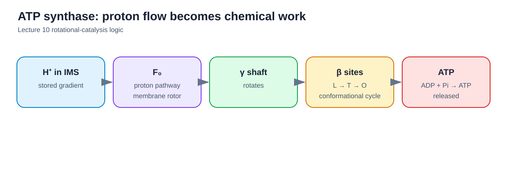
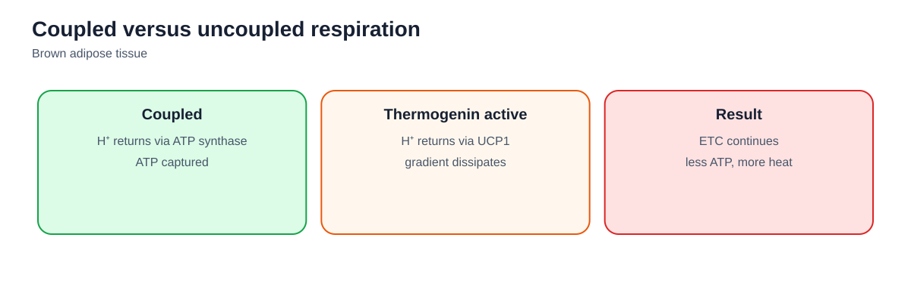

## How to use this guide

The Week 10 lecture determines scope. Alberts Chapter 14 supplies the detailed mechanistic framework. Tutorial 6 reinforces the same sequence from mitochondrial structure through ATP synthase and thermogenin.

The main chain is:

**NADH/FADH2 → electron-transport chain → proton pumping → proton-motive force → ATP synthase → ATP**

<figure class="study-visual">

<figcaption><strong>Visual roadmap.</strong> Lecture 10; Tutorial 6; Alberts Chapter 14.</figcaption>
</figure>

## 1. Mitochondrial structure

Know four regions:

1. **Outer membrane**
2. **Intermembrane space**
3. **Inner membrane**
4. **Matrix**

### Outer membrane

The outer membrane contains a variety of proteins and enzymes and is relatively permeable to small molecules compared with the inner membrane.

### Inner membrane

The inner membrane is:

- highly selective;
- strongly folded into **cristae**;
- rich in protein;
- the location of the respiratory-chain complexes and ATP synthase.

Cells with high rates of respiration tend to have mitochondria with densely packed cristae.

### Intermembrane space

The ETC pumps protons **from the matrix into the intermembrane space**.

### Matrix

The matrix contains enzymes for pyruvate oxidation and the citric acid cycle and is the compartment from which protons are pumped during electron transport.

<figure class="study-visual">

<figcaption><strong>Mitochondrial compartments.</strong> Lecture 10:4–5; Tutorial 6:9.</figcaption>
</figure>

## 2. Electron carriers

### NADH

NADH carries **2 electrons at a time**.

### FADH2

FADH2 can participate in transfers involving **1 or 2 electrons**.

This flexibility matters because some parts of electron transport move pairs of electrons while cytochromes transfer electrons one at a time.

### Cytochromes

Cytochromes contain heme groups whose iron cycles between oxidation states.

A cytochrome carries **1 electron at a time**.

This distinction is a frequent exam target.

<figure class="study-visual">

<figcaption><strong>Electron-carrier comparison.</strong> Lecture 10:7–8; Tutorial 6:10.</figcaption>
</figure>

## 3. Electron flow down the ETC

Electrons derived from NADH or FADH2 are passed through a sequence of carriers in the inner mitochondrial membrane.

As electrons move through energetically favorable redox steps toward oxygen, free energy is released gradually.

The important point is:

> The ETC does not use this energy to phosphorylate ADP directly.

Instead, the energy is conserved by pumping protons across the inner mitochondrial membrane.

## 4. The final electron acceptor

**Molecular oxygen (O2)** is the final electron acceptor.

At Complex IV, electrons are ultimately transferred to oxygen, which combines with protons to form water.

Without oxygen, the electron-transport chain backs up because the final acceptor is unavailable.

## 5. Which complexes pump protons?

The lecture emphasizes:

- **Complex I — pumps H+**
- **Complex II — does NOT pump H+**
- **Complex III — pumps H+**
- **Complex IV — pumps H+**

Direction:

**matrix → intermembrane space**

Complex II is especially important to remember because it transfers electrons from FADH2-derived pathways without directly pumping protons.

<figure class="study-visual course-source-visual">

<figcaption><strong>Course visual — electron flow pays for proton pumping.</strong> Faithful adaptation of Lecture 10:13–18 and Tutorial 6:13.</figcaption>
</figure>

<figure class="study-visual source-original-visual">

<figcaption><strong>Original textbook figure — respiratory chain and proton pumping.</strong> Source: Alberts et al. 2023, <em>Essential Cell Biology</em>, Ch. 14 PDF p. 11, Fig. 14–14. Permission status: pending.</figcaption>
</figure>

## 6. Proton-motive force

Pumping H+ creates an electrochemical gradient across the inner mitochondrial membrane.

This stored energy is the **proton-motive force**.

It has two components:

- a **concentration gradient** — more H+ outside the matrix;
- an **electrical gradient** — charge separation across the membrane.

The inner membrane must be sufficiently impermeable to protons for this stored energy to be maintained.

## 7. Chemiosmotic coupling

The ETC and ATP synthesis are linked by the proton gradient.

This is **chemiosmotic coupling**:

1. electron transfer releases energy;
2. respiratory complexes use that energy to pump H+;
3. the proton gradient stores potential energy;
4. H+ flows back toward the matrix through ATP synthase;
5. ATP synthase uses this flow to drive ATP production.

## 8. ATP synthase: overall organization

ATP synthase has two functional regions:

- **F0** — the membrane-embedded proton-conducting portion;
- **F1** — the catalytic head projecting into the matrix.

H+ movement through F0 drives rotation of internal components.

The central γ subunit rotates relative to the stationary αβ catalytic head.

The αβ dimers themselves do not simply spin as a unit; they change conformation in response to rotation of the central shaft.

## 9. The three β-subunit conformations

The catalytic sites cycle through three states:

### Open

- low affinity for nucleotides;
- ATP is released;
- ADP and Pi can enter.

### Loose

- ADP and Pi are bound.

### Tight

- ADP and Pi are brought into a configuration that favors ATP formation.

Rotation forces each catalytic β subunit to move sequentially through these conformations.

<figure class="study-visual course-source-visual">

<figcaption><strong>Course visual — L, T and O states.</strong> Faithful adaptation of Tutorial 6:15 and Lecture 10:24.</figcaption>
</figure>

The core idea is mechanical coupling:

**proton flow → rotation → conformational change → ATP synthesis/release**

<figure class="study-visual">

<figcaption><strong>ATP synthase as a rotary machine.</strong> Lecture 10:20–24; Alberts Chapter 14.</figcaption>
</figure>

## 10. Substrates for ATP synthesis

The chemical substrates are:

- **ADP**
- **Pi**

They must be available in the mitochondrial matrix.

The inner membrane contains transport systems that exchange ATP and ADP and bring phosphate into the matrix.

For exam purposes, distinguish:

- ATP synthase **makes** ATP from ADP + Pi;
- membrane transport proteins ensure that ADP and Pi reach the matrix and ATP can leave.

## 11. Why FADH2 yields less proton pumping than NADH

NADH donates electrons through Complex I.

FADH2-derived electrons enter at Complex II, bypassing Complex I.

Because Complex II does not pump protons, FADH2-linked electron transfer supports less total proton pumping than NADH-linked transfer.

The conceptual consequence is lower ATP yield from FADH2-derived electrons.

## 12. Uncoupling

Normally, proton return is tightly coupled to ATP synthesis.

An **uncoupler** allows H+ to return to the matrix without passing through ATP synthase.

Electron transport can continue, but the energy of the proton gradient is released largely as heat rather than captured as ATP.

## 13. Thermogenin

**Thermogenin**, also called uncoupling protein 1 (UCP1), is found in the inner mitochondrial membrane of brown adipose tissue.

It forms a route for protons to move back toward the matrix without driving ATP synthase.

Therefore:

- electron transport can continue;
- proton pumping can continue;
- the gradient is dissipated;
- less ATP is generated;
- more energy is released as **heat**.

This is the biochemical basis of non-shivering thermogenesis in brown adipose tissue.

<figure class="study-visual">

<figcaption><strong>Thermogenin: uncoupling on purpose.</strong> Lecture 10:28–31; Tutorial 6:16.</figcaption>
</figure>

## 14. Week 10 learning-objective checklist

You should be able to explain:

- the four mitochondrial regions;
- why cristae matter;
- electrons carried by NADH, FADH2, and cytochromes;
- why FADH2's 1-or-2-electron flexibility matters;
- how electron flow is coupled to proton pumping;
- the proton-motive force;
- which ETC complexes pump H+;
- the direction of proton pumping;
- ADP and Pi as ATP-synthesis substrates;
- how substrates/products cross the inner membrane;
- the open, loose, and tight ATP-synthase states;
- thermogenin and uncoupling.

## Takeaway

Electron transport and ATP synthesis are not the same process.

The ETC converts **redox energy into a proton gradient**.

ATP synthase converts **the proton gradient into ATP**.
