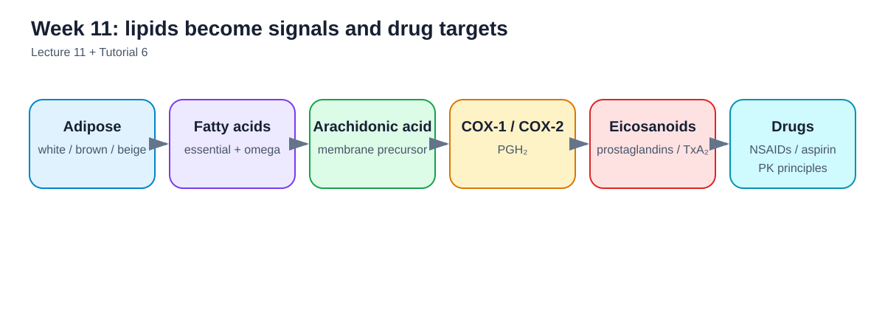
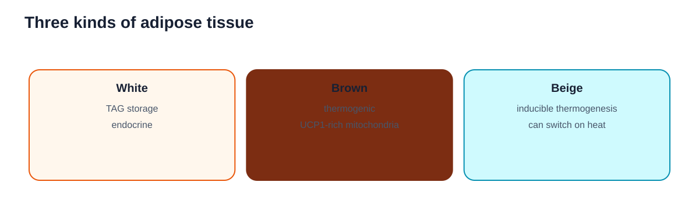
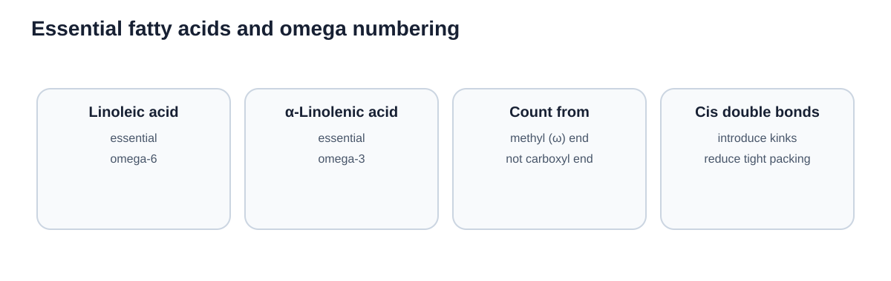
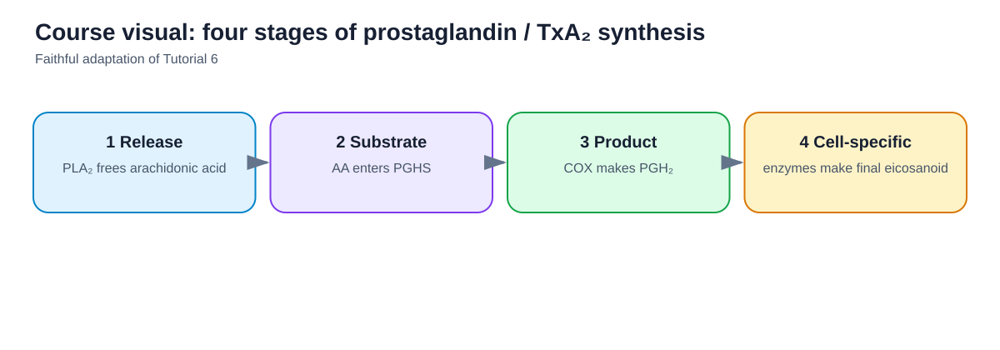
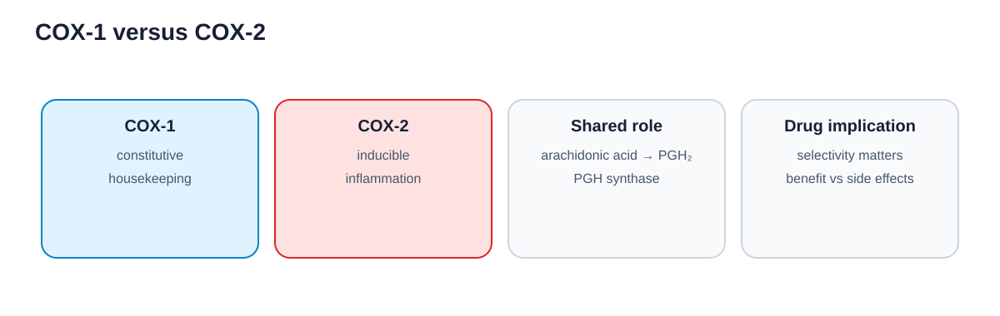
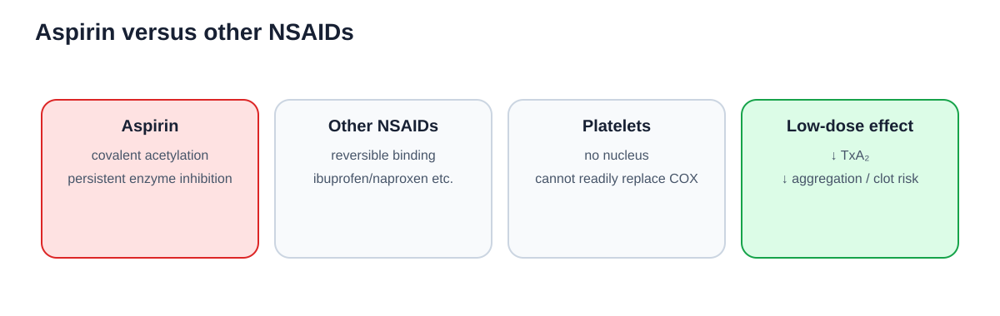
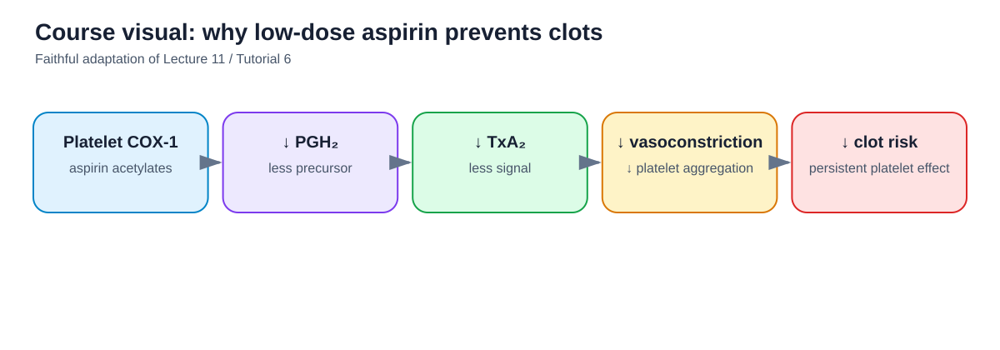
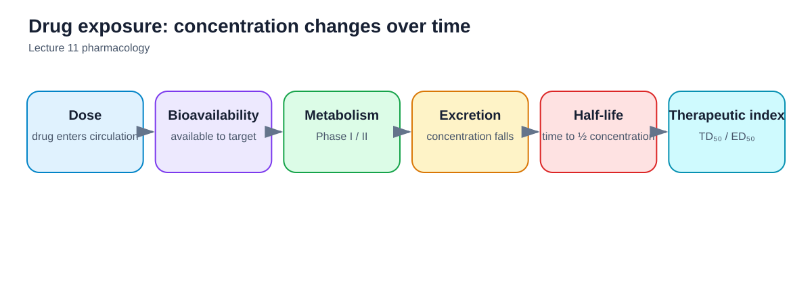

## How to use this guide

The Week 11 lecture is the authority for scope. Alberts Chapters 11 and 15 provide relevant membrane and intracellular context, but several examinable topics—eicosanoids, NSAIDs, aspirin, acetaminophen, bioavailability, therapeutic index, agonists, and antagonists—come specifically from the lecture and tutorial material.

<figure class="study-visual">

<figcaption><strong>Visual roadmap.</strong> Lecture 11; Tutorial 6.</figcaption>
</figure>

## 1. White, brown, and beige adipose tissue

### White adipose tissue

White adipose tissue is the most common adipose tissue.

Its major functions include:

- storage of triacylglycerols (TAGs);
- endocrine functions.

### Brown adipose tissue

Brown adipose tissue is specialized for **thermogenesis**.

Its cells are rich in mitochondria containing uncoupling protein/thermogenin.

Brown adipocytes arise from a lineage distinct from ordinary white adipocytes.

### Beige adipose tissue

Beige adipocytes can develop thermogenic properties in response to appropriate stimulation.

The lecture emphasizes **inducible thermogenesis** as their defining feature.

<figure class="study-visual">

<figcaption><strong>Three kinds of adipose tissue.</strong> Lecture 11:2; Tutorial 6:19.</figcaption>
</figure>

## 2. Fatty-acid structure

Fatty acids vary mainly in:

- chain length;
- number and position of double bonds.

A **cis double bond** introduces a bend in the hydrocarbon chain and reduces tight van der Waals packing.

This structural effect helps explain why unsaturation changes lipid physical properties.

## 3. Essential fatty acids

An **essential fatty acid** is required for normal physiology but cannot be synthesized adequately by animals and therefore must be obtained from the diet.

The lecture identifies:

- **linoleic acid**
- **α-linolenic acid**

as essential fatty acids.

## 4. Omega-3 and omega-6 nomenclature

Omega nomenclature counts from the **methyl (omega) end** of the fatty acid.

- **omega-3:** the first double bond begins at carbon 3 from the methyl end.
- **omega-6:** the first double bond begins at carbon 6 from the methyl end.

Do not count from the carboxyl end when assigning omega numbers.

<figure class="study-visual">

<figcaption><strong>Essential fatty acids and omega numbering.</strong> Lecture 11:3–4; Tutorial 6:20.</figcaption>
</figure>

## 5. Eicosanoids

**Eicosanoids** are 20-carbon signaling molecules derived from oxidation of polyunsaturated fatty acids.

They participate in processes including:

- inflammation;
- fever;
- pain;
- blood clotting;
- blood-pressure regulation;
- gastric mucosal protection;
- reproduction;
- sleep/wake regulation.

Major categories mentioned in the lecture include:

- prostaglandins;
- thromboxanes;
- leukotrienes;
- lipoxins.

## 6. Arachidonic acid: the key precursor

For the prostaglandins and thromboxane A2 pathway emphasized in this course, the key precursor is **arachidonic acid**.

Arachidonic acid is commonly esterified in membrane phospholipids.

Following tissue injury or signaling, **phospholipase A2** can release it from the membrane.

## 7. Four stages of prostaglandin/TxA2 synthesis

The course simplifies the pathway into four stages.

### Stage 1

Arachidonic acid is released from a membrane phospholipid.

### Stage 2

Arachidonic acid becomes the substrate for **PGH synthase (PGHS)**.

PGHS has two major isoforms:

- **COX-1**
- **COX-2**

### Stage 3

PGHS converts arachidonic acid into the unstable intermediate **PGH2**.

### Stage 4

Cell-specific enzymes convert PGH2 into particular eicosanoids.

Different cells therefore make different downstream products.

For example, platelets contain thromboxane synthase and convert PGH2 to **thromboxane A2 (TxA2)**.

<figure class="study-visual course-source-visual">

<figcaption><strong>Course visual — four stages of eicosanoid synthesis.</strong> Faithful adaptation of Tutorial 6:23 and Lecture 11:7–8.</figcaption>
</figure>

<figure class="study-visual source-original-visual">

<figcaption><strong>Original lecture graphic — eicosanoid synthesis pathway.</strong> Source: Week 11 lecture, <em>Chapter 15 MBB201-11 — Lipids</em>, PDF p. 7. Permission status: pending.</figcaption>
</figure>

## 8. COX-1 and COX-2

### COX-1

COX-1 is generally described in the lecture as:

- constitutively expressed in many tissues;
- associated with **housekeeping** prostaglandin production;
- involved in functions such as gastric mucosal protection.

### COX-2

COX-2 is generally:

- inducible;
- expressed strongly in selected cells/tissues in response to inflammatory stimuli;
- associated with inflammatory pain, fever, and swelling.

The two isoforms are related but have structural differences in the substrate-access channel.

<figure class="study-visual">

<figcaption><strong>COX-1 versus COX-2.</strong> Lecture 11:8–9; Tutorial 6:24.</figcaption>
</figure>

## 9. NSAIDs

Common nonsteroidal anti-inflammatory drugs block access of **arachidonic acid** to the COX active site.

The lecture emphasizes three major effects of NSAIDs:

- analgesic;
- antipyretic;
- anti-inflammatory.

Because ordinary NSAIDs can inhibit both COX-1 and COX-2, they can suppress both inflammatory prostaglandins and useful COX-1 housekeeping functions.

## 10. Aspirin is unusual

Aspirin inhibits COX enzymes by **covalently acetylating** an active-site serine.

This distinguishes aspirin from several other common NSAIDs that bind reversibly/noncovalently.

Because covalent inhibition persists after free aspirin has disappeared, enzyme function does not return simply by aspirin dissociation.

<figure class="study-visual">

<figcaption><strong>Aspirin versus other NSAIDs.</strong> Lecture 11:13–15; Tutorial 6:25.</figcaption>
</figure>

## 11. Low-dose aspirin and platelets

Platelets produce **TxA2**, which promotes platelet aggregation and contributes to blood clot formation.

Low-dose aspirin reduces TxA2 production by covalently inhibiting platelet COX.

The crucial course point is that platelets lack nuclei and cannot readily replace the inhibited COX enzyme by new gene expression and protein synthesis.

Thus a brief exposure to aspirin can have a prolonged antiplatelet effect.

Ordinary reversible NSAIDs do not produce the same persistent platelet inhibition.

<figure class="study-visual course-source-visual">

<figcaption><strong>Course visual — low-dose aspirin prevents clots.</strong> Faithful adaptation of Lecture 11:17 and Tutorial 6:28.</figcaption>
</figure>

## 12. Why a COX-2-selective inhibitor can be useful

Because COX-2 is strongly associated with inflammatory responses while COX-1 supports many housekeeping functions, a COX-2-selective inhibitor can reduce inflammatory pain while sparing more COX-1 activity.

The lecture also notes that selectivity does not automatically mean risk-free; some COX-2-selective drugs have been withdrawn because of cardiovascular risk.

## 13. Acetaminophen is not treated as an NSAID here

The lecture specifically distinguishes acetaminophen from NSAIDs.

For this course:

- acetaminophen is an **analgesic**;
- acetaminophen is an **antipyretic**;
- it does not inhibit COX at the site of peripheral tissue injury in the way NSAIDs do;
- therefore it does not effectively reduce local inflammatory swelling.

The lecture explicitly notes that the detailed mechanism for its analgesic/antipyretic action remains uncertain.

## 14. Bioavailability

The course defines **bioavailability** operationally as the amount of drug present in circulation and available to reach its target.

Drug concentration declines as the body metabolizes and excretes the compound.

Thus dosage and dosing interval must be considered relative to metabolism.

## 15. Half-life

Drug **half-life** is the time required for the concentration in the bloodstream to fall to one-half of its starting value.

Half-life helps determine dosing frequency.

## 16. Drug metabolism

The lecture emphasizes two broad phases:

- **Phase I:** often oxidation, frequently through cytochrome P450 enzymes;
- **Phase II:** conjugation to groups such as glucuronic acid, sulfate, or glutathione.

These transformations commonly make compounds easier to excrete.

## 17. Therapeutic index

The **therapeutic index (TI)** compares the dose producing toxicity with the dose producing the desired effect.

A common form is:

$$
TI = \frac{TD_{50}}{ED_{50}}
$$

or, when lethality is measured:

$$
TI = \frac{LD_{50}}{ED_{50}}
$$

A larger therapeutic index generally indicates a wider margin between effective and toxic doses.

<figure class="study-visual">

<figcaption><strong>Drug exposure and safety.</strong> Lecture 11:19–23; Tutorial 7:3–4.</figcaption>
</figure>

## 18. Agonists and antagonists

An **agonist**:

- binds to a receptor;
- activates it;
- elicits a response.

An **antagonist**:

- binds to a receptor;
- does not activate it;
- blocks or reduces activation by an agonist.

## 19. Week 11 learning-objective checklist

You should be able to explain:

- white versus brown versus beige adipose tissue;
- essential fatty acids;
- omega-3 and omega-6 definitions;
- eicosanoids;
- the four stages of the prostaglandin/TxA2 pathway;
- arachidonic acid as precursor;
- COX-1 versus COX-2;
- how NSAIDs block the COX active site;
- why aspirin is different from reversible NSAIDs;
- low-dose aspirin and platelet TxA2;
- rationale for COX-2-selective inhibitors;
- why acetaminophen is not treated as an NSAID in this lecture;
- bioavailability and half-life;
- therapeutic index;
- agonists and antagonists.

## Takeaway

The central biochemical pathway is:

**membrane phospholipid → arachidonic acid → COX-1/COX-2 → PGH2 → cell-specific eicosanoids**

The pharmacology questions ask what happens when different drugs interrupt that pathway—or change receptor activity elsewhere.
